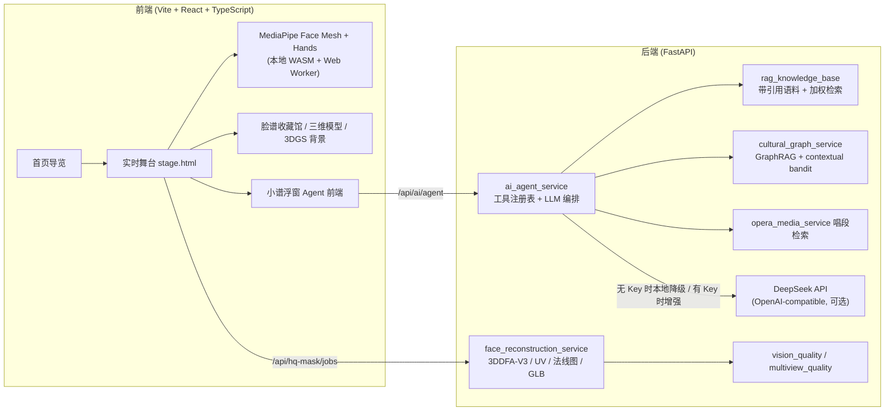

# AI-Opera · 智能川剧变脸体验馆

> **English**: AI-Opera is an interactive Sichuan-opera "face-changing" (变脸) web experience. It combines real-time face/gesture tracking (MediaPipe), a cited RAG knowledge base, a GraphRAG cultural knowledge graph, a tool-calling guide agent, and a personalized 3D mask generation pipeline (3DMM fitting → UV baking → GLB export).

      

AI-Opera 把**实时视觉交互**、**可溯源的川剧文化知识库**和**个性化三维脸谱生成**组织成同一条体验链路：用户在摄像头前挥手、转头、举扇即可触发变脸；随行的 AI 导览"小谱"基于 RAG 与知识图谱讲解当前脸谱的角色、颜色寓意与剧目出处，并能根据观展行为推荐下一张脸谱。

## 项目亮点

- **工具型导览 Agent**：后端 Agent 维护数据驱动的工具注册表（RAG 检索、GraphRAG 子图、contextual bandit 推荐、系统健康、生成画像、唱段检索），先取工具结果再调用 LLM 生成回答；每次工具调用记录 `status` 与 `latencyMs`，支持多轮对话（`history`），回答自动附带来源引用块。未配置 LLM Key 时自动降级为纯本地 RAG 回答，**离线可演示**。
- **带引用的 RAG 知识库**：85 条语料、35 个独立来源，由中国非遗网、文旅部、Smithsonian、CCTV、CGTN、China Daily、四川省政府、重庆市文化和旅游研究院、Wikipedia 等公开资料整理而成，每条语料保留 `source` 与 `sourceUrl`，回答可追溯到出处（见 [`docs/rag_sources.md`](docs/rag_sources.md)）。检索为 v2 加权词法方案：字段加权打分 + 中英同义扩展 + CJK 短语加分 + 单来源多样性约束，语料经 `lru_cache` 预计算索引。
- **GraphRAG 文化知识图谱**：将"角色—颜色—寓意—剧目"构建为图结构，问答时沿关系取一跳子图作为上下文，而非平面文档拼接（方法论参照 [Microsoft GraphRAG, arXiv 2404.16130](https://arxiv.org/abs/2404.16130)，本项目为其确定性轻量实现）。
- **Contextual Bandit 推荐**：根据当前佩戴脸谱、观展历史与偏好事件实时计算下一张脸谱的推荐理由（novelty / 颜色对照 / 寓意桥接 / 剧目桥接 / 曝光惩罚 / 图谱丰富度六项特征），形成"策展式"导览动线。
- **个性化三维脸谱生成管线**：多视角采集 → 清晰度/姿态筛选 → 3DMM 脸型拟合（3DDFA-V3，可选）→ 脸谱 UV 烘焙 → 细节法线图 → Blender/trimesh 导出 GLB，全程写入 manifest，可解释、可追溯。
- **全自托管的实时视觉**：MediaPipe Face Landmarker（478 关键点 + 52 blendshape）与 Hands 的 WASM 模型直接随仓库分发，摄像头帧在本地 Web Worker 中处理，不上传原始画面。
- **3D Gaussian Splatting 陈列馆**：使用 `@mkkellogg/gaussian-splats-3d` 渲染 `.ksplat` 实景背景（雷峰塔、华清池），与三维脸谱模型 viewer 集成（方法论出处 [3DGS, SIGGRAPH 2023](https://arxiv.org/abs/2308.04079)）。

## 架构总览



## 快速开始

### 1. 前端

```bash
npm install
npm run dev        # http://localhost:3000
```

### 2. 后端（CPU 模式）

```powershell
npm run setup:cpu  # 创建 .venv-cpu 并安装 FastAPI / numpy / pillow / trimesh 等
npm run dev:cpu    # 启动 FastAPI（默认 http://127.0.0.1:8000）
```

也可以手动启动：

```bash
python -m uvicorn backend.app:app --port 8000
```

未配置 GPU 或未下载 3DDFA-V3 权重时，系统会自动降级：体验馆、收藏馆、RAG/Agent 导览、三维模型展示全部可用，仅"个性化三维面罩重建"走前端 OBJ 或 mock 路径。

### 3. 测试与 CI

后端带有离线 pytest 套件（RAG 检索、GraphRAG、bandit 推荐、Agent 工具编排、HTTP API），不需要 GPU 和 LLM Key：

```bash
pip install -r requirements.txt -r requirements-dev.txt
pytest          # 36 个测试
ruff check backend
```

GitHub Actions（`.github/workflows/ci.yml`）在每次 push / PR 时自动执行后端 pytest + ruff lint 和前端 `tsc + vite build`。

### 4. Docker（后端 API）

```bash
docker build -t ai-opera-api .
docker run -p 8000:8000 --env-file .env ai-opera-api
```

### 5. 环境变量

复制 `.env.example` 为 `.env`（`.env` 不会被提交）：

| 变量 | 说明 |
| --- | --- |
| `DEEPSEEK_API_KEY` | 可选。配置后 Agent 走 DeepSeek Chat Completion；留空则使用本地 RAG 降级 |
| `DEEPSEEK_BASE_URL` | 默认 `https://api.deepseek.com`，兼容任何 OpenAI-style 端点 |
| `DEEPSEEK_MODEL` | 默认 `deepseek-v4-flash` |
| `HQ_MASK_FACE_PROVIDER` | 三维面罩提供方：`auto` / `3ddfa` / `mock` |
| `DDFA_V3_DEVICE` | `cpu` 或 `cuda` |
| `AI_CLIP_SERVICE_URL` | 可选。外部 CLIP 服务地址；留空使用本地颜色直方图降级检索 |
| `AI_SAM_SERVICE_URL` | 可选。外部 SAM2 服务地址；留空使用基于人脸关键点的多边形遮挡分割降级 |

> ⚠️ 不要把真实 API Key 写入源码或文档。项目定位是"个性化三维脸谱面罩"，**不是**身份级高保真人脸重建系统。

## API 一览（节选）

| 路由 | 功能 |
| --- | --- |
| `GET /api` | API 索引：版本与全部端点分组（机器可读） |
| `POST /api/ai/agent` | 工具型 Agent：RAG + GraphRAG + bandit 推荐 + 系统状态 → LLM 编排回答；支持 `history` 多轮对话，返回 `citations` 与带延迟的工具调用记录 |
| `POST /api/ai/ask` / `GET /api/ai/rag/search` | RAG 问答与语料检索（返回命中片段、来源与打分） |
| `GET /api/ai/rag/stats` | 语料统计：文档总数、分类分布、独立来源数 |
| `GET /api/ai/graph` | 角色-颜色-寓意-剧目知识图谱查询 |
| `POST /api/ai/recommend` | contextual bandit 脸谱推荐（含六项推荐特征） |
| `POST /api/ai/visual-qa` / `POST /api/ai/clip/search` | 视觉问答与图-脸谱检索（外部 CLIP 接口 + 本地降级） |
| `POST /api/ai/sam/segment` | 遮挡分割（外部 SAM2 接口 + 关键点引导多边形降级） |
| `POST /api/hq-mask/jobs` / `POST /api/personal-face/jobs` | 个性化三维脸谱面罩生成任务（采集 → 拟合 → UV → GLB） |
| `GET /api/opera/media/{face_key}` | 按脸谱匹配川剧唱段与原视频检索入口 |
| `GET /api/3dgs/scenes` | 3D Gaussian Splatting 背景场景清单 |

完整路由见 [`backend/app.py`](backend/app.py)。

## 目录结构

```
├─ index.html / stage.html      # Vite 入口：首页 + 实时舞台
├─ src/                         # React 首页与舞台背景源码
├─ public/
│  ├─ legacy/                   # 舞台、收藏馆、知识页、小谱浮窗等核心页面与运行时
│  ├─ mediapipe/                # 自托管 Face Mesh / Hands WASM 模型
│  ├─ 3dgs/                     # 3DGS 陈列馆背景 (.ksplat)
│  └─ generated_masks/          # 示例个人三维脸谱 OBJ
├─ backend/
│  ├─ app.py                    # FastAPI 路由
│  ├─ services/                 # RAG / GraphRAG / Agent / 重建 / 质检 / 唱段等服务
│  └─ tests/                    # pytest 套件（RAG / GraphRAG / Agent / API）
├─ .github/workflows/ci.yml     # GitHub Actions：pytest + ruff + 前端构建
├─ docs/                        # 技术答辩剖析、RAG 来源整理
├─ scripts/                     # CPU/GPU 环境安装与启动脚本
└─ training/                    # 手势关键点样本采集与训练脚本
```

## 诚实的边界说明

为了让评估者清楚系统各部分的真实状态：

- **RAG 检索**是带权重字段的词法检索（标题/标签/正文/上下文加权 + 中英同义扩展 + CJK 短语加分 + 来源多样性约束），不是向量嵌入检索；语料规模为 85 条 / 35 个独立来源，当前精度足以支撑导览场景，`/api/ai/rag/stats` 暴露真实规模。
- **CLIP / SAM2** 通过环境变量接入外部模型服务；未配置时使用项目内置的轻量降级实现（颜色直方图检索、关键点引导遮挡多边形），页面会明示当前 provider。
- **3DDFA-V3** 权重（超过 GitHub 100MB 限制）不随仓库分发，需按 [`RUN_GPU.md`](RUN_GPU.md) 与 [`backend/README_HQ_MASK_PIPELINE.md`](backend/README_HQ_MASK_PIPELINE.md) 单独恢复；未配置时相关任务自动降级。
- 情绪驱动换脸基于 MediaPipe blendshape 阈值路由，属于规则化映射，不宣称情绪识别的心理学效力。

## 深入阅读

- [`docs/AI-Opera_项目技术细节答辩剖析.md`](docs/AI-Opera_项目技术细节答辩剖析.md) — 架构与生成管线细节
- [`docs/rag_sources.md`](docs/rag_sources.md) — RAG 语料来源清单
- [`DESIGN.md`](DESIGN.md) — 视觉与交互规范
- [`PRODUCT.md`](PRODUCT.md) — 产品定位与设计原则

## License

[MIT](LICENSE)
